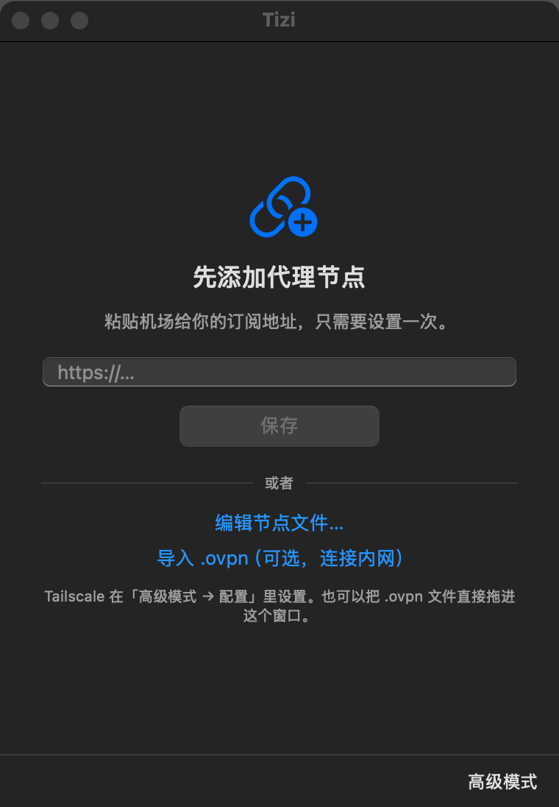
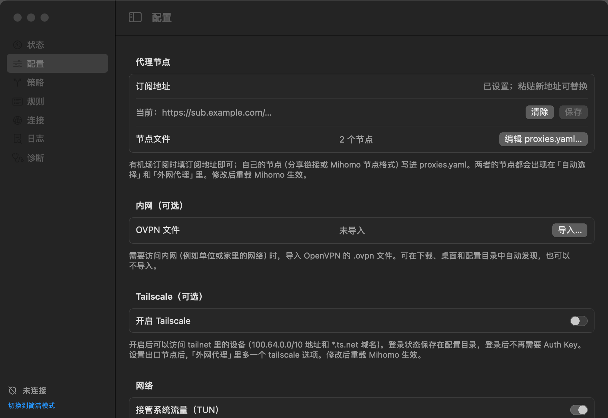

# Tizi

基于 [Mihomo](https://github.com/MetaCubeX/mihomo) 的代理工具（“梯子”）：填好机场订阅或自己的节点，点「连接」，国内网站直连、海外网站走代理，不用自己写规则。需要的话，还能同时连上公司或家里的内网（导入 `.ovpn`）和 Tailscale。支持 macOS 和 Ubuntu。

<p align="center">
  
</p>

## 功能

**连接与分流**

- 粘贴机场订阅地址就能用；也可以用节点文件写自己的节点（分享链接或 Clash 节点格式）
- 自动分流：国内网站和私有地址直连，海外网站走「外网代理」；订阅里的节点按延迟自动选择，也可以手动指定
- 接管系统流量（TUN）和 DNS，断开或崩溃后自动恢复原来的网络设置
- 连接期间关闭物理网卡的公网 IPv6，防止海外网站绕过代理
- 支持自定义分流规则，可以在界面里测试某个网址走哪条线路
- 一键修复微信图片发不出去；诊断页逐项检查，有问题的项标橙或标红

**内网（可选）**

- 导入 OpenVPN 的 `.ovpn` 文件，内网域名和网段走 VPN，其余流量照常分流，不会全部绕进内网
- 内网域名、网段、DNS 默认从 `.ovpn` 的 `route`、`dhcp-option` 读取，也可以自己填写
- 内网里有 HTTP 出口时，可以把它作为「外网代理」的一个选项
- 隧道断开（密钥重协商、服务端轮换、睡眠唤醒）后自动恢复；支持 `tls-crypt`、`tls-crypt-v2`、`tls-auth`、证书和用户名密码登录

**Tailscale（可选）**

- 不用装 Tailscale 客户端：Tizi 以一台设备的身份加入你的 tailnet，`100.64.0.0/10` 和 MagicDNS 域名（`*.ts.net`）走 Tailscale
- 支持官方服务器和自建的 Headscale；可以选一台出口节点（exit node）作为「外网代理」的一个选项

**Claude 线路检测和报警**

- `claude.ai`、`claude.com`、`anthropic.com`、`claudeusercontent.com` 固定走「Claude」线路，这条线路没有直连选项，自定义规则也改不了；没有任何代理节点时 Claude 直接打不开，不会直连
- 可以给 Claude 单独配一个住宅节点，经「前置代理」链式连接或本机直接连接
- 平时每 30 秒检测一次 Claude 的实际线路和出口 IP；直连、连不上、出口在不支持的地区时几秒内弹出置顶提醒
- 直连保护（macOS）：用系统防火墙拦截不经隧道发往 Anthropic 的连接，VPN 断开时 Claude 也不会直连

**界面**

- macOS 桌面版：简洁模式只有一个「连接」按钮；高级模式可以看实时连接、切换线路、改规则、看日志和诊断；菜单栏图标随时连接或断开
- 终端版：和高级模式一样的 7 个页面，适合 Ubuntu 和 SSH 登录的服务器。两个版本共用设置和运行状态，可以同时打开
- 有新版本时提示，一键更新；所有操作都有对应的命令行
- 手机上的 Clash Mi 扫码导入当前配置；TraceScope 在浏览器里用 3D 地球显示实时连接线路

## 准备

- 一台 Mac（macOS 13 或更新），或 Ubuntu 22.04 / 24.04 x86_64（桌面版或服务器版）
- 至少一种线路：机场订阅地址、自己的节点、内网 `.ovpn` 文件或 Tailscale 账号

> 订阅地址、节点密码、`.ovpn` 和 Tailscale Auth Key 都是你的个人凭据，不要发给别人，也不要上传到任何地方。

## 安装

打开「终端」（Mac 上按 `Command + 空格`，输入“终端”），粘贴下面这行命令，按回车：

```sh
curl -fsSL https://raw.githubusercontent.com/kadaliao/Tizi/main/install.sh | sh
```

看到“安装完成”就好了。Mac 上会同时装好桌面版。

也可以从 [Releases](https://github.com/kadaliao/Tizi/releases) 下载 `Tizi-vX.Y.Z.dmg`，打开后把「TiziDesktop」拖进「Applications」。应用没有 Apple 公证，首次打开要按磁盘映像里的说明，在「系统设置 → 隐私与安全性」点一次「仍要打开」。首次连接会自动下载 Mihomo 核心，需要能访问 github.com。

## 使用

**Mac 桌面版**

1. 运行 `open ~/Applications/TiziDesktop.app`，以后也可以在访达的「个人文件夹 → 应用程序」里双击打开。
2. 第一次打开时粘贴机场订阅地址。没有订阅时，可以点「编辑节点文件…」写自己的节点，或导入内网 `.ovpn`；Tailscale 在「高级模式 → 配置」里开启。
3. 点「连接」，弹出密码框时输入这台 Mac 的登录密码。看到「已连接」就可以用了。

**终端版**（Ubuntu，或习惯命令行的 Mac 用户）

运行 `~/.local/bin/tizi`，用方向键移动，`Enter` 确认：

1. 按 `2` 进入「配置」页，在「订阅地址」上按 `Enter` 粘贴订阅地址（直接粘贴也可以）。导入 `.ovpn` 时把文件拖进终端，或选中「内网 OVPN」后按 `s` 扫描。
2. 按 `1` 回到「状态」页，第一次先选「安装 Mihomo 核心」，再选「启动 Mihomo」。
3. 按提示输入登录密码（输入时屏幕不显示字符），看到「运行中」就连上了。

按 `?` 查看全部按键。退出时选「停止并退出」会断开连接，选「保持运行退出」让它继续在后台运行，之后用 `tizi stop` 断开。

## 配置线路

所有设置在桌面版「高级模式 → 配置」和终端版「配置」页都能改，也可以用命令行参数（见下文），修改后重载 Mihomo 生效。

<p align="center">
  
</p>

**订阅**：填机场给的订阅地址（Clash / Mihomo 格式或 Base64 分享链接都可以）。Mihomo 自己下载订阅，每天更新一次。订阅地址里有令牌，界面上只显示主机名。

**节点文件**：`~/.config/tizi/proxies.yaml`，从界面点「编辑节点文件…」打开（终端版用 `$EDITOR`）。两种写法任选一种：

```text
# 每行一个分享链接
trojan://password@example.com:443?sni=example.com#my-trojan
ss://YWVzLTI1Ni1nY206cGFzc3dvcmQ@203.0.113.10:8388#my-ss
```

```yaml
# Mihomo 节点格式：节点会逐个出现在「外网代理」和「Claude」的选项里
proxies:
  - {name: my-trojan, type: trojan, server: example.com, port: 443, password: your-password, sni: example.com}
  - {name: home-socks, type: socks5, server: 127.0.0.1, port: 1080}
```

订阅和节点文件里的节点都进「自动选择」（按延迟挑最快的）和「外网代理」。

**内网**：导入 `.ovpn` 后会多出「内网」线路。下面几项留空时用 `.ovpn` 里的值：

| 设置 | 作用 | 留空时 |
| --- | --- | --- |
| 内网域名 | 这些域名后缀走内网，并交给内网 DNS 解析 | `.ovpn` 的 `dhcp-option DOMAIN` |
| 内网网段 | 这些 IP 段走内网 | `.ovpn` 的 `route`，没有时 `10.0.0.0/8` |
| 内网 DNS | 经隧道查询内网域名 | `.ovpn` 的 `dhcp-option DNS` |
| 内网 HTTP 出口 | 内网里的 HTTP 代理（`host:port`），可在「外网代理」里选用 | 不使用 |
| 内网检查地址 | 一个内网里的网址，用来及时发现隧道失效 | 用内网 HTTP 出口；都没有时只在睡眠唤醒后重建隧道 |

服务端推送的路由和 DNS 不在 `.ovpn` 文件里，连上后访问不了内网时，问管理员要内网的网段、域名和 DNS 填进去。

**Tailscale**：打开「Tailscale」，首次登录填一个 Auth Key（在 Tailscale 后台 Settings → Keys 生成，形如 `tskey-auth-…`）。登录状态保存在 `~/.config/tizi/tailscale/`，之后不再需要 Auth Key。设备名默认是 `tizi-主机名`；使用 Headscale 时填「控制服务器」地址。填了「出口节点」后，「外网代理」里多一个 `tailscale` 选项，经那台设备上网。已经在用 Tailscale 客户端时，两者只开一个，否则 tailnet 地址会被 Tizi 的 TUN 接管。

## 常见问题

**连不上，或者连上了网页打不开**：先断开 Tunnelblick 等其他 VPN。桌面版点「遇到问题 → 网页打不开：重新连接」；还不行就点「遇到问题 → 查看诊断详情」，看哪一项标了橙色或红色。终端版按 `7` 查看诊断。

**海外网站打不开**：多半是订阅下载失败或节点不可用。在诊断页确认「代理节点」一项正常，然后在「策略」页给「外网代理」换一个节点。订阅换了内容想立即更新时，删除 `~/.config/tizi/providers/subscription.yaml` 后运行 `tizi reload`。

**微信图片发不出去**：桌面版点「遇到问题 → 微信图片发不出去」，或运行 `tizi recover-wechat`。

**怎么更新**：当前版本是 `v1.0.0`。有新版本时桌面版会提示，点「更新」即可；也可以点菜单栏图标里的「检查更新…」，或运行 `tizi update`。

**关掉窗口后还连着吗**：连着。退出程序时会问你「停止并退出」还是「保持运行退出」。

**想让国内流量也走代理**：在高级模式的「配置」页把「国内流量」改成「走外网代理」，再点「重载 Mihomo」。

**Ubuntu 提示系统不支持**：需要 Ubuntu 22.04 / 24.04 x86_64 和系统自带的 `systemd-resolved`。运行 `tizi diagnose` 看缺什么；提示 `systemd-resolved 不可用` 时，运行 `sudo systemctl restart systemd-resolved` 后重试。

## 进阶

<details>
<summary><strong>Claude 住宅节点、访问监测和直连保护</strong></summary>

**住宅节点**：桌面版在「配置」页的「Claude」一节按项填写协议、主机、端口、用户名和密码。服务商给的整段地址可以直接粘贴到「主机」，会自动拆开（`socks5://用户名:密码@主机:端口`、`主机:端口:用户名:密码` 等常见写法都认识）。终端版在「Claude 住宅节点」填完整地址。ss、trojan、vless 等其他协议点「编辑 claude-proxy.yaml…」，按 Mihomo 节点格式写。

连接方式有两种：

- **经前置代理链式连接**（默认）：本机 → 「前置代理」（订阅或节点文件里的节点）→ 住宅节点。从国内访问住宅节点更稳定，Claude 看到的是住宅 IP。可以在「策略」页给「前置代理」选一个固定的节点。
- **本机直接连接**：本机 → 住宅节点。国内直连明文的 HTTP / SOCKS5 节点容易被干扰，建议用加密协议。没有任何代理节点、或节点地址是本机（例如 SSH 端口转发出来的 `127.0.0.1`）时，总是直接连接。

住宅节点连不上时，Claude 打不开并弹窗，不会自动换线路，避免出口 IP 来回切换。急用时可以在弹窗或策略页把「Claude」临时切到其他代理节点，重新连接或重载 Mihomo 后会自动切回住宅节点。

**访问监测**：配置了住宅节点时自动开启；没配置时可以在「配置」页打开「Claude 访问监测」。检测请求的是 `https://claude.ai/cdn-cgi/trace`，由 Cloudflare 边缘直接返回出口 IP 和地区，不带账号信息，也不到达 Anthropic 的服务器。

- 一次检测失败后 3 秒复查，仍失败才弹窗；同一个问题只弹一次，恢复后窗口变成绿色的「已恢复」。
- 桌面版没开时（用终端版，或「保持运行退出」后），由后台进程用 macOS 系统弹窗提醒。
- 整机断网时只提示「网络已断开」；睡眠唤醒后 30 秒内不弹「连不上」。关闭 TUN、或改了住宅节点还没重载时，状态页显示橙色提示，不弹窗。
- 主动断开或选「停止并退出」后，访问 Claude 会直连，不会提醒；需要彻底防止直连时打开直连保护。
- Ubuntu 上没有弹窗，用 `tizi claude-check` 检查，有问题时退出码非零。

**直连保护（macOS）**：在「配置」页打开「直连保护」（终端版「Claude 直连保护」，或 `tizi claude-block on`），需要输入一次登录密码。它用系统自带的 pf 防火墙拦截不经隧道、直接发往 Anthropic 网段（`160.79.104.0/21`、`2607:6bc0::/32`）的连接。

- 连接正常时没有影响，Claude 的流量走 TUN 隧道。
- 开机时由系统后台任务 `/Library/LaunchDaemons/com.kadaliao.tizi.claude-block.plist` 加载规则，之后每分钟检查一次；规则挂在 `/etc/pf.conf` 已有的 `com.apple/*` 锚点下，不修改 pf.conf。
- 诊断页、`claude-block status` 和访问监测都会自检是否生效；自检不接触 Anthropic 的真实地址。
- 关闭时删除规则和后台任务。`downloads.claude.ai` 不在 Anthropic 网段，不受保护；Ubuntu 暂不支持。

</details>

<details>
<summary><strong>命令行</strong></summary>

把 `~/.local/bin` 加入 `PATH` 后可以直接使用 `tizi`：

```sh
tizi start                        # 连接；--no-tun 只提供本地代理，--proxy-china 国内流量也走代理
tizi stop
tizi reload                       # 重新生成配置并重启，让设置和规则修改生效
tizi status
tizi diagnose
tizi update
tizi install-core                 # 加 --channel alpha 安装滚动 Alpha 构建
tizi validate
tizi recover-wechat               # 只刷新微信直连，不重启
tizi claude-check                 # 检测 Claude 的线路和出口 IP
tizi claude-block on|off|status   # Claude 直连保护（macOS）
tizi clash-qr                     # 手机扫码导入
tizi tracescope                   # 网络可视化看板
tizi version
```

`generate`、`validate`、`start`、`reload` 接受下面的参数，并把它们保存到设置里：

```sh
tizi start --subscription 'https://example.com/api/v1/client/subscribe?token=...'
tizi start --ovpn ~/Downloads/office.ovpn --intranet-domains corp.example.com --intranet-dns 10.0.0.53
tizi start --tailscale --tailscale-auth-key tskey-auth-... --tailscale-exit-node home-server
tizi start --ovpn ''              # 移除内网
```

其他参数：`--remote a,c`（只用指定的 OpenVPN remote）、`--intranet-cidrs`、`--intranet-http HOST:PORT`、`--no-tailscale`、`--allow-lan --proxy-user NAME --proxy-auth`（局域网代理，要求用户名和密码，没有密码时自动生成）。完整列表见 `tizi help`。

</details>

<details>
<summary><strong>配置文件和自定义规则</strong></summary>

运行数据保存在 `~/.config/tizi/`：

| 文件 | 内容 |
| --- | --- |
| `settings.json` | 用户设置，桌面版和终端版共用；包含订阅地址和 Tailscale Auth Key |
| `config.yaml` | 生成的 Mihomo 配置，包含节点密码、个人证书和私钥 |
| `proxies.yaml` | 可选：节点文件 |
| `custom-rules.txt` | 自定义分流规则 |
| `claude-proxy.yaml` | 可选：Mihomo 节点格式的 Claude 住宅节点 |
| `providers/`、`tailscale/` | Mihomo 下载的订阅缓存和 Tailscale 登录状态 |
| `mihomo.log` | 日志，最多 5 MiB，另保留两份历史 |

`custom-rules.txt` 每行一条 Mihomo 规则，`#` 开头是注释：

```text
DOMAIN-SUFFIX,example.com,外网代理
DOMAIN,api.example.com,DIRECT
DOMAIN-SUFFIX,corp.example.com,内网
IP-CIDR,203.0.113.0/24,DIRECT,no-resolve
```

可用线路有 `外网代理`、`默认出口`、`Claude`、`DIRECT`、`REJECT`，导入 `.ovpn` 后还有 `内网`，开启 Tailscale 后还有 `Tailscale`。自定义规则可以覆盖内置的固定域名规则，Claude 的域名除外。保存时会校验，出错会指出行号；安装和更新不会覆盖这个文件。修改后运行 `tizi reload` 生效，也可以在「规则」页直接测试和保存。

</details>

<details>
<summary><strong>在 Ubuntu 服务器上使用</strong></summary>

SSH 登录后运行 `~/.local/bin/tizi`，用法同上；退出时选「保持运行退出」，连接会继续在后台运行。服务器自己和 Docker 容器的出站流量按规则分流，SSH 等入站连接不受影响。

- **服务器下载不了安装包或 Mihomo**：在本机下载 Release 里的 `tizi-linux-amd64.tar.gz`，`scp` 到服务器的 `~/.local/bin/`。下载 Mihomo 太慢时借本机代理：`ssh -R 27891:127.0.0.1:7890 服务器` 登录，再运行 `TIZI_HTTP_PROXY=http://127.0.0.1:27891 tizi install-core`。
- **给其他机器用**：开「局域网代理」时一定同时设置「代理用户名」和「代理密码」，否则任何人都能用这个端口。认证信息以明文经过网络，只在必要时开启。
- 腾讯云的软件源、NTP 和 metadata（`*.tencentyun.com`、`169.254.0.0/16`）固定直连。

</details>

<details>
<summary><strong>手机扫码导入和 TraceScope</strong></summary>

**Clash Mi 扫码导入**：电脑和手机连同一个局域网，在桌面版高级模式点「Clash Mi 扫码导入」（或运行 `tizi clash-qr`），在 Clash Mi 的「我的配置」点 `+` →「扫描二维码」。导入的配置不包含内置 Tailscale 和分享链接写法的节点文件。二维码最多开放 5 分钟；配置里有订阅地址、节点密码或证书，导入后立即关闭分享，不要截图或转发。

**TraceScope**：连接后运行 `tizi tracescope`，浏览器会打开 <http://127.0.0.1:8788/>。首次运行需要 Node.js 20+。端口、最多线路数和本机位置的设置见 [TraceScope README](internal/tracescope/web/README.md)。

</details>

<details>
<summary><strong>它是怎么工作的</strong></summary>

Tizi 把你的订阅、节点、`.ovpn` 和 Tailscale 设置生成一份 Mihomo 配置，通过 TUN 接管系统流量，按顺序匹配：

1. Apple 推送服务直连；内网域名和网段走「内网」；`100.64.0.0/10` 和 `*.ts.net` 走「Tailscale」。
2. 微信、飞书等国内服务按域名固定直连。
3. Claude 与 Anthropic 的域名走「Claude」（住宅节点或代理节点，不会直连）。
4. 你的自定义规则。
5. YouTube、Gemini 生成媒体等固定域名走「外网代理」。
6. 私有地址和中国大陆 IP 直连，其余走「默认出口」（默认是「外网代理」）。

运行期间 Tizi 会接管 DNS：macOS 保存并在断开时恢复原网络服务的 DNS，为内网域名写 `/etc/resolver` 文件；Ubuntu 通过 `systemd-resolved` 给 `tizi` 网卡配置 DNS 路由，并在停止、崩溃或下次启动时撤销。TUN 只接管 IPv4，所以连接期间还会关闭物理网卡的公网 IPv6（macOS 改为「仅本地链路」，Ubuntu 设 `disable_ipv6=1`），断开时按 `dns-state.json` 里的记录还原。只有连接后网络设置才会改变。

</details>

<details>
<summary><strong>开发与发布</strong></summary>

需要 Go 1.25+；桌面版需要 Xcode，见 [macos/README.md](macos/README.md)。

```sh
go test ./...
make lint
make build                 # bin/tizi
make install install-gui   # 安装到本机
```

测试和诊断不会启动 Mihomo，也不会接管系统网络。

发布在装有 Xcode 的 Mac 上本地构建，用 GitHub CLI 上传：

```sh
VERSION=v1.0.0
go test -race ./...
make lint
make release VERSION="$VERSION"
git tag "$VERSION"
git push --atomic origin main "refs/tags/$VERSION"
gh release create "$VERSION" dist/* --verify-tag --title "$VERSION" --notes-file /path/to/release-notes.md
```

各版本变更见 [CHANGELOG](CHANGELOG.md)。

</details>
