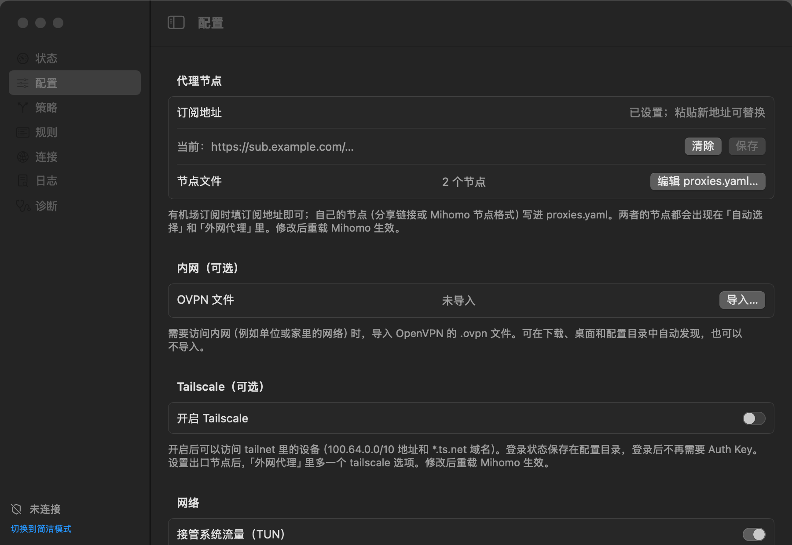

# 配置线路

所有设置在桌面版「高级模式 → 配置」和终端版「配置」页都能改，也可以用[命令行参数](cli.md)，修改后重载 Mihomo 生效。

<p align="center">
  
</p>

## 订阅

填机场给的订阅地址（Clash / Mihomo 格式或 Base64 分享链接都可以）。Mihomo 自己下载订阅，每天更新一次。订阅地址里有令牌，界面上只显示主机名。

订阅换了内容想立即更新时，删除 `~/.config/tizi/providers/subscription.yaml` 后运行 `tizi reload`。

## 节点文件

`~/.config/tizi/proxies.yaml`，从界面点「编辑节点文件…」打开（终端版用 `$EDITOR`）。两种写法任选一种，不要混用：

```text
# 每行一个分享链接（ss://、vmess://、trojan://、vless://、hysteria2:// 等，也可以整体 Base64 编码）
trojan://password@example.com:443?sni=example.com#my-trojan
ss://YWVzLTI1Ni1nY206cGFzc3dvcmQ@203.0.113.10:8388#my-ss
```

```yaml
# Mihomo 节点格式：节点会逐个出现在「外网代理」和「Claude」的选项里
proxies:
  - {name: my-trojan, type: trojan, server: example.com, port: 443, password: your-password, sni: example.com}
  - {name: home-socks, type: socks5, server: 127.0.0.1, port: 1080}
```

订阅和节点文件里的节点都进「自动选择」（按延迟挑最快的）和「外网代理」。订阅里的说明条目（剩余流量、套餐到期、官网地址等）不参与自动选择。「策略」页可以测速，每个节点旁边显示延迟。节点名不能和内置的线路名（「外网代理」「DIRECT」等）重复。

## 内网

导入 OpenVPN 的 `.ovpn` 后会多出「内网」线路：内网域名和网段走 VPN，其余流量照常分流，不会全部绕进内网。支持 `tls-crypt`、`tls-crypt-v2`、`tls-auth`、证书和用户名密码登录；隧道因密钥重协商、服务端轮换或睡眠唤醒断开后会自动恢复。

下面几项留空时用 `.ovpn` 里的值：

| 设置 | 作用 | 留空时 |
| --- | --- | --- |
| 内网域名 | 这些域名后缀走内网，并交给内网 DNS 解析 | `.ovpn` 的 `dhcp-option DOMAIN` |
| 内网网段 | 这些 IP 段走内网 | `.ovpn` 的 `route`，没有时 `10.0.0.0/8` |
| 内网 DNS | 经隧道查询内网域名 | `.ovpn` 的 `dhcp-option DNS` |
| 内网 HTTP 出口 | 内网里的 HTTP 代理（`host:port`），可在「外网代理」里选用 | 不使用 |
| 内网检查地址 | 一个内网里的网址，用来及时发现隧道失效 | 用内网 HTTP 出口；都没有时只在睡眠唤醒后重建隧道 |

服务端推送的路由和 DNS 不在 `.ovpn` 文件里。连上后访问不了内网时，问管理员要内网的网段、域名和 DNS 填进去。

## Tailscale

不用装 Tailscale 客户端：Tizi 以一台设备的身份加入你的 tailnet，`100.64.0.0/10` 和 MagicDNS 域名（`*.ts.net`）走 Tailscale。

- 打开「Tailscale」，首次登录填一个 Auth Key（在 Tailscale 后台 Settings → Keys 生成，形如 `tskey-auth-…`）。登录状态保存在 `~/.config/tizi/tailscale/`，之后不再需要 Auth Key。
- 设备名默认是 `tizi-主机名`；使用自建的 Headscale 时填「控制服务器」地址。
- 填了「出口节点」后，「外网代理」里多一个 `tailscale` 选项，经那台设备上网。
- 已经在用 Tailscale 客户端时，两者只开一个，否则 tailnet 地址会被 Tizi 的 TUN 接管。

## 其他设置

- **国内流量**：默认直连；改成「走外网代理」后国内网站也经代理。
- **TUN 模式**：默认接管系统流量；关闭后只提供本地代理端口（Mixed 端口，默认 `7890`）。
- **局域网代理**：允许其他设备使用本机代理端口。开启后建议同时要求用户名和密码：桌面版在「配置 → 网络」打开「要求用户名和密码」，密码自动生成，可以显示、复制或重新生成；终端版和命令行见 [Ubuntu 服务器](linux-server.md)。
- **Claude 住宅节点**：见 [Claude 线路保护](claude.md)。
